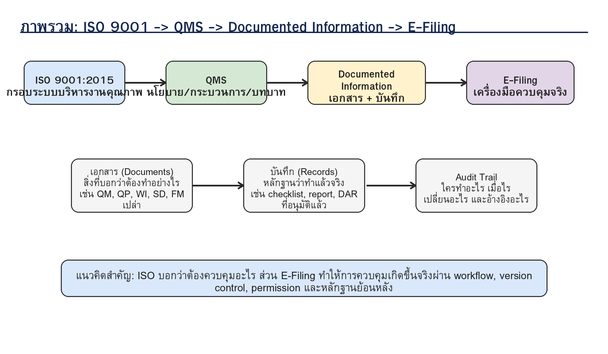
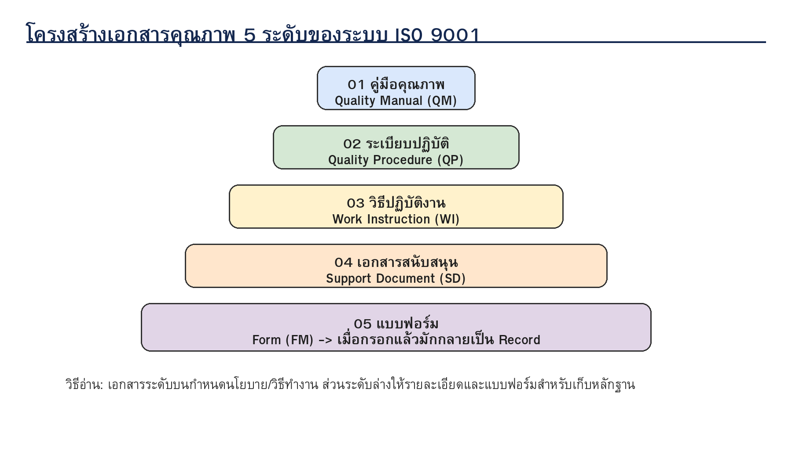
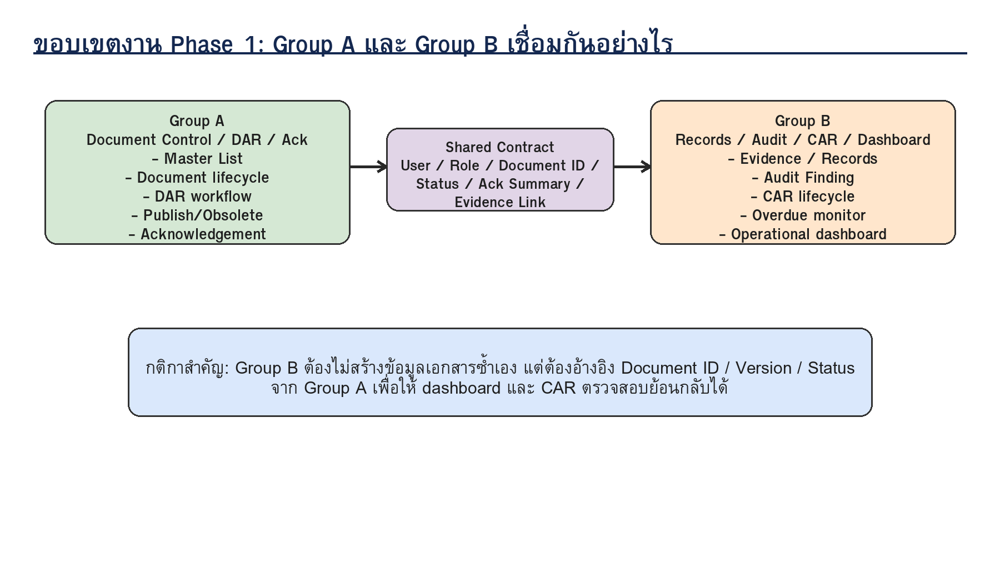
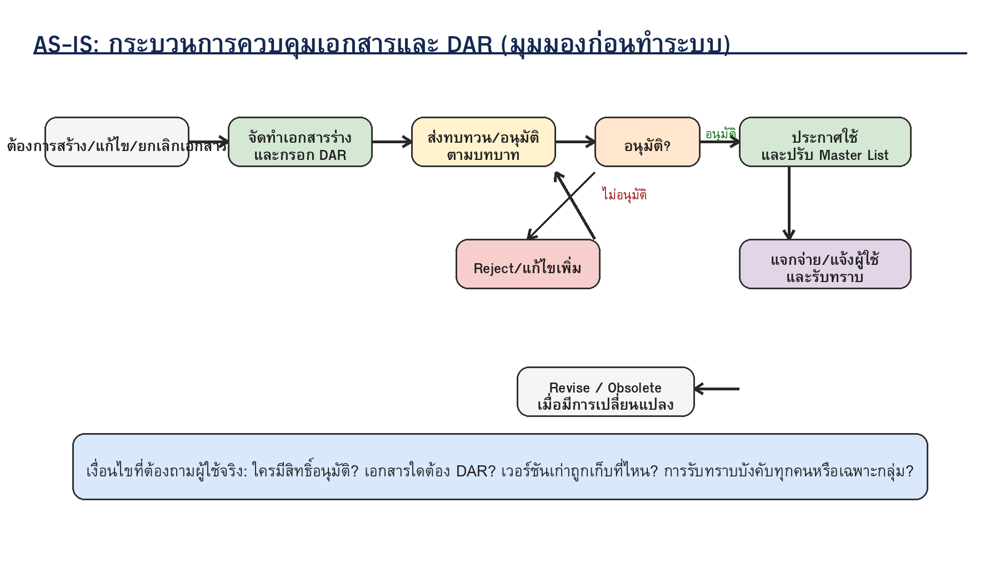
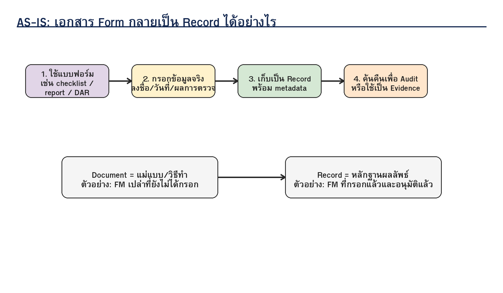
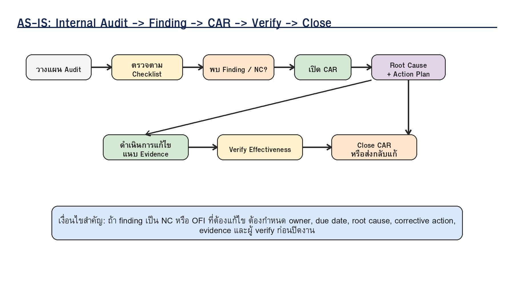
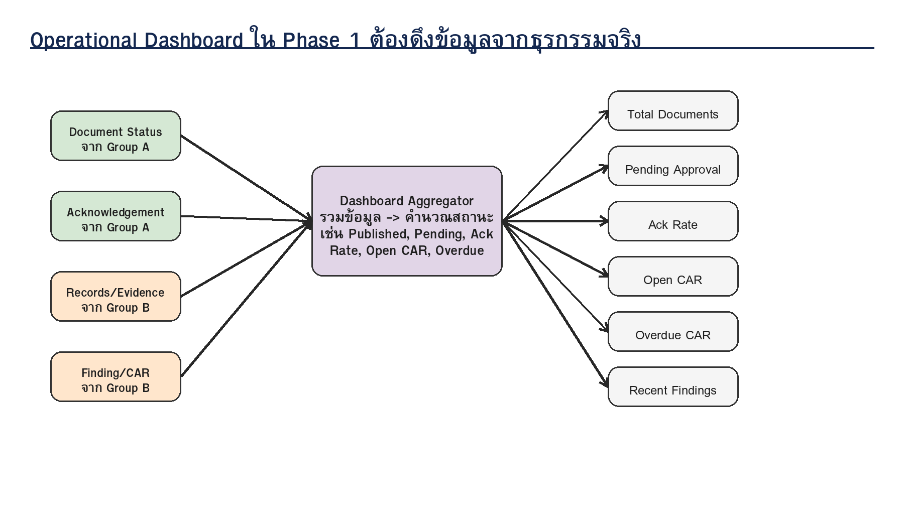

# คู่มือทำความเข้าใจ AS-IS และบริบท ISO 9001 สำหรับระบบ E-Filing Phase 1
## ระบบบริหารงานคุณภาพ ISO 9001:2015 สำนักงานคณบดีคณะวิศวกรรมศาสตร์ มทร.ล้านนา

**Version:** Draft 1.0  
**Audience:** ทีม Group A, Group B, BA/PO, อาจารย์ที่ปรึกษา, ผู้ใช้งานจริง/ผู้ปฏิบัติงานจริง  
**Purpose:** ใช้เป็นเอกสารทำความเข้าใจบริบทการทำงานจริงก่อนนำเสนอ/สัมภาษณ์ผู้ใช้งาน และก่อนแตก ERD/API/Scenario/UAT

---

## 1. ทำไมต้องมีเอกสารนี้

เอกสารนี้ทำหน้าที่เป็น “คู่มือภาษาคนทำงาน” เพื่ออธิบายว่าในระบบบริหารงานคุณภาพ ISO 9001 นั้น เอกสารแต่ละชนิดคืออะไร ทำไมต้องมี ทำไมต้องควบคุม และกระบวนการ AS-IS ที่ทีมควรเข้าใจก่อนออกแบบระบบ E-Filing มีขั้นตอนและเงื่อนไขอะไรบ้าง

เอกสารนี้ไม่ใช่คู่มือ ISO อย่างเป็นทางการ แต่เป็นเอกสารประกอบการวิเคราะห์ระบบ โดยอ้างอิงจาก:

- เอกสารจริงของโครงการ เช่น Master Plan, Phase 1 BRD, SE02 Group A และ SE02 Group B
- แนวทาง ISO 9001:2015 ในประเด็น documented information, internal audit และ corrective action
- ขอบเขตที่ตกลงร่วมกัน: **Phase 1 MVP + Operational Dashboard**

> ข้อควรจำ: “ISO คือกรอบที่บอกว่าต้องควบคุมอะไร ส่วน E-Filing คือเครื่องมือที่จะทำให้การควบคุมนั้นเกิดขึ้นจริงในงานประจำวัน”

---

## 2. ภาพรวม ISO 9001 และระบบบริหารงานคุณภาพ (QMS)

ISO 9001 เป็นมาตรฐานระบบบริหารงานคุณภาพที่ช่วยให้องค์กรกำหนดกระบวนการ ทำงานให้เป็นระบบ ตรวจสอบได้ และปรับปรุงต่อเนื่อง โดย ISO อธิบายว่า ISO 9001 ช่วยให้องค์กรปรับปรุง performance, meet customer expectations และ demonstrate commitment to quality [EXT-1]

สำหรับโครงการนี้ ความหมายเชิงปฏิบัติคือ:

- งานต้องมีขั้นตอนที่ชัดเจน
- เอกสารต้องบอกได้ว่าใครต้องทำอะไร
- เมื่อทำงานแล้วต้องมี record เป็นหลักฐาน
- เมื่อตรวจพบปัญหา ต้องมี finding/CAR และติดตามจนปิด
- ผู้บริหารและผู้เกี่ยวข้องต้องมองเห็นสถานะระบบได้ผ่าน dashboard

---

## 3. Documented Information คืออะไร

ใน ISO 9001:2015 คำว่า **Documented Information** ครอบคลุมทั้งเอกสารที่ต้อง “maintain” เพื่อให้ระบบทำงานได้ และ records ที่ต้อง “retain” เพื่อเป็นหลักฐานว่าทำงานตามแผน [EXT-2]

สรุปแบบเข้าใจง่าย:

| ประเภท | ความหมาย | ตัวอย่างในโครงการ | ใช้ทำอะไร |
|---|---|---|---|
| Document | สิ่งที่บอกวิธีทำงานหรือข้อกำหนด | QM, QP, WI, SD, FM เปล่า | ใช้สื่อสารวิธีทำงาน |
| Record | หลักฐานว่าทำงานแล้วจริง | แบบฟอร์มที่กรอกแล้ว, audit report, CAR record | ใช้ตรวจสอบย้อนหลัง |
| Audit Trail | บันทึกเหตุการณ์ในระบบ | ใครสร้าง/แก้ไข/อนุมัติ/รับทราบ | ใช้พิสูจน์ความโปร่งใส |

ISO Annex SL อธิบายว่า documented information อาจอยู่ในรูปแบบหรือสื่อใดก็ได้ และอาจหมายถึง management system, documentation หรือ evidence of results achieved (records) [EXT-3]

---

## 4. โครงสร้างเอกสารคุณภาพของสำนักงานคณบดี

จากข้อมูลโครงการ ระบบเอกสารคุณภาพแบ่งออกเป็น 5 ระดับหลัก:

1. **QM - Quality Manual / คู่มือคุณภาพ**: เอกสารระดับบนสุด อธิบายระบบบริหารคุณภาพและขอบเขต
2. **QP - Quality Procedure / ระเบียบปฏิบัติ**: อธิบายกระบวนการหลัก เช่น การควบคุมเอกสาร การตรวจติดตาม การแก้ไขป้องกัน
3. **WI - Work Instruction / วิธีปฏิบัติงาน**: อธิบายขั้นตอนปฏิบัติรายงานหรือรายหน้าที่
4. **SD - Support Document / เอกสารสนับสนุน**: เอกสารอ้างอิง แผน ตาราง ข้อกำหนด หรือข้อมูลสนับสนุน
5. **FM - Form / แบบฟอร์ม**: แบบฟอร์มที่ใช้กรอกข้อมูล เมื่อกรอกแล้วจะกลายเป็น record

### ทำไมต้องแยกเอกสารเป็นระดับ

การแยกระดับช่วยให้ทีมเข้าใจว่าเอกสารใด “กำหนดกรอบ” เอกสารใด “กำหนดวิธีทำ” และเอกสารใด “ใช้เก็บหลักฐาน” หากไม่แยก จะทำให้ระบบค้นหา/ควบคุม/อนุมัติ/เก็บรักษาเอกสารยากขึ้น

---

## 5. เอกสารจริงที่ทีมต้องรู้จัก

เอกสารจริงที่ใช้เป็นข้อมูลดิบของโครงการ ได้แก่:

| กลุ่มเอกสาร | ตัวอย่าง | ความสำคัญต่อระบบ |
|---|---|---|
| QM | QM-2301-01 คู่มือคุณภาพ | ใช้เป็นภาพรวมระบบ QMS |
| QP | QP-2301-0107 การควบคุมเอกสาร | เป็น process แม่ของ Group A |
| QP | QP-2301-0102 การตรวจติดตามคุณภาพภายใน | เป็น process แม่ของ audit ใน Group B |
| QP | QP-2301-0109 การแก้ไขและการป้องกัน | เป็น process แม่ของ CAR ใน Group B |
| FM | FM-QP-2301-0107-01 DAR | เป็นต้นแบบ workflow เปลี่ยนแปลงเอกสาร |
| FM | FM-QP-2301-0107-02 Master List | เป็นต้นแบบ document registry |
| FM | Audit Checklist / Audit Report / NC Form | เป็นต้นแบบ audit record |
| FM | Corrective Action Request | เป็นต้นแบบ CAR |

---

## 6. ขอบเขต Phase 1 ที่ทีมต้องจำให้ได้

Phase 1 ของโครงการนี้คือ **Foundation Control Layer** โดยเน้นให้ระบบควบคุมเอกสารและหลักฐานได้จริงก่อน ไม่ใช่ทำ dashboard ขั้นสูงหรือ analytics เต็มระบบ

### Group A: Document Control / DAR / Ack

รับผิดชอบงานต้นทางของเอกสาร:

- จัดการ Document Master
- สร้าง/แก้ไขเอกสาร
- ควบคุมสถานะ Draft -> Review -> Approved -> Published -> Obsolete
- จัดการ DAR
- ควบคุม current version
- จัดการ acknowledgement
- ส่งข้อมูล document status / ack summary ให้ Group B

### Group B: Records / Audit / CAR / Dashboard

รับผิดชอบงานหลักฐานและการติดตาม:

- จัดการ record/evidence
- บันทึก audit finding
- เปิดและติดตาม CAR
- คำนวณ overdue
- ทำ operational dashboard
- ใช้ข้อมูลจาก Group A เป็นแหล่งอ้างอิง ไม่สร้าง document master ซ้ำ

---

# ส่วนที่ 1: AS-IS ของงานควบคุมเอกสาร (Group A)

## 7. AS-IS: การสร้าง/แก้ไข/ยกเลิกเอกสารผ่าน DAR

กระบวนการนี้คือหัวใจของ Group A เพราะเกี่ยวข้องกับ QP การควบคุมเอกสารและแบบฟอร์ม DAR

### 7.1 เหตุการณ์ที่ทำให้ต้องเริ่ม DAR

ตัวอย่าง trigger:

- มีเอกสารใหม่ที่ต้องใช้ในระบบคุณภาพ
- มีการแก้ไขขั้นตอนทำงาน
- มีการเปลี่ยนเจ้าของเอกสาร/ผู้รับผิดชอบ
- พบว่าเอกสารเดิมไม่สอดคล้องกับงานจริง
- ผล audit หรือ CAR ทำให้ต้องแก้เอกสาร
- เอกสารเลิกใช้แล้ว ต้อง obsolete หรือทำลายตามรอบ

### 7.2 ขั้นตอน AS-IS ที่ควรเข้าใจ

| ขั้น | ผู้เกี่ยวข้อง | สิ่งที่ทำ | เอกสาร/ข้อมูลที่เกิดขึ้น | เงื่อนไขสำคัญ |
|---|---|---|---|---|
| 1 | Document Owner | เตรียมร่างเอกสารหรือแก้ไขเอกสาร | Draft document | ต้องระบุรหัส/ชื่อ/ประเภท/เหตุผล |
| 2 | Document Owner | กรอก DAR | DAR | ต้องระบุ action type เช่น new/revise/obsolete |
| 3 | Reviewer/Approver | ทบทวนความเหมาะสม | comment/decision | ถ้าไม่ผ่าน ต้องกลับไปแก้ |
| 4 | ISO/QA Admin | ตรวจ metadata, version, status | Master List update | ต้องไม่ให้ current version ซ้ำ |
| 5 | ISO/QA Admin | Publish / Obsolete | Published document / obsolete record | ต้องกำหนด effective date |
| 6 | End User | รับทราบเอกสารที่เกี่ยวข้อง | Acknowledgement record | ต้องเก็บ user/time/version |

### 7.3 เงื่อนไขที่ต้องถามผู้ใช้งานจริง

- DAR ใช้กับเอกสารทุกประเภทหรือเฉพาะ QM/QP/WI/FM บางชนิด?
- เอกสารใดต้องอนุมัติชั้นเดียว เอกสารใดต้องหลายชั้น?
- ผู้อนุมัติเป็นคนเดียวกับหัวหน้างานหรือ ISO/QA Admin หรือไม่?
- เมื่อ reject ต้องสร้าง DAR ใหม่หรือใช้ DAR เดิมแก้ไขต่อ?
- เมื่อ publish เอกสารใหม่ เอกสารเก่าถูก obsolete อัตโนมัติหรือทำด้วยมือ?
- กำหนด effective date ย้อนหลังได้หรือไม่?
- ใครบ้างต้องรับทราบเอกสาร และรับทราบตาม department หรือ role?

### 7.4 ความเสี่ยงของ AS-IS แบบ manual

- ใช้เอกสารผิด version
- DAR หายหรือติดค้างโดยไม่รู้สถานะ
- Master List ไม่ตรงกับไฟล์จริง
- เอกสารเก่ายังถูกแจกจ่ายหรือใช้งานต่อ
- ไม่มีหลักฐานว่าผู้ใช้รับทราบเวอร์ชันใหม่แล้ว

### 7.5 สิ่งที่ระบบควรเปลี่ยนจาก AS-IS เป็น TO-BE

| AS-IS | TO-BE ในระบบ |
|---|---|
| DAR เป็นไฟล์/กระดาษ | DAR เป็น workflow ในระบบ |
| ติดตามสถานะด้วยการถามคน | มี status และ approval queue |
| Master List อัปเดตแยก | ข้อมูล document master เป็นฐานกลาง |
| รับทราบด้วยลายเซ็น/ช่องทางอื่น | acknowledgement เก็บ user/time/version |
| current version ตรวจด้วยคน | ระบบบังคับ current version เดียว |

---

## 8. AS-IS: Master List คืออะไรและทำไมต้องดูแล

**Master List** คือทะเบียนรายชื่อเอกสารทั้งหมดในระบบคุณภาพ เป็นเหมือน “ทะเบียนกลาง” ที่บอกว่าองค์กรมีเอกสารอะไรบ้าง เอกสารแต่ละฉบับมีรหัสอะไร ชื่ออะไร ประเภทอะไร ฉบับที่เท่าไร สถานะอะไร และยังใช้งานอยู่หรือไม่

### ทำไม Master List สำคัญ

- ทำให้รู้ว่าเอกสารใดเป็น current version
- ป้องกันเอกสารซ้ำซ้อนหรือรหัสซ้ำ
- เป็นหลักฐานให้ auditor ตรวจว่าสำนักงานมีระบบควบคุมเอกสารจริง
- เป็นแหล่งข้อมูลหลักสำหรับ dashboard และ search

### เงื่อนไขที่ต้องคุม

- รหัสเอกสารต้องไม่ซ้ำ
- เอกสารที่ Published ต้องมีฉบับปัจจุบันชัดเจน
- เอกสาร Obsolete ต้องไม่ถูกใช้เป็น operational document
- การแก้ไข Master List ต้องมีเหตุผลหรืออ้าง DAR

---

## 9. AS-IS: การแจกจ่ายเอกสารและการรับทราบ

การ publish เอกสารยังไม่จบที่การเปลี่ยนสถานะ เพราะเอกสารที่มีผลต่อการทำงานต้องสื่อสารให้ผู้เกี่ยวข้องรับทราบ

### ขั้นตอนที่ควรเกิดขึ้น

1. ISO/QA Admin publish เอกสาร
2. ระบบหรือผู้ดูแลกำหนดกลุ่มผู้เกี่ยวข้อง
3. ผู้ใช้งานเปิดอ่านเอกสาร current version
4. ผู้ใช้งานกดรับทราบหรือมีหลักฐานการรับทราบ
5. ISO/QA Admin ดูรายงานว่าใครรับทราบแล้ว/ยังไม่รับทราบ

### เงื่อนไขที่ต้องถามผู้ใช้งานจริง

- เอกสารประเภทใดต้อง acknowledgement?
- acknowledgement ต้องทำทุก revision หรือเฉพาะ major revision?
- ถ้าผู้ใช้ไม่รับทราบภายในกำหนด ต้องเตือนอย่างไร?
- ต้องเก็บหลักฐานการรับทราบนานเท่าไร?

---

## 10. AS-IS: การยกเลิกเอกสารและการทำลายเอกสาร

เอกสารที่ไม่ใช้แล้วต้องถูกควบคุม ไม่ใช่แค่ลบไฟล์ เพราะ auditor อาจต้องดูประวัติย้อนหลังว่าทำไมเอกสารนี้ถูกยกเลิก และมีเอกสารใดมาแทน

### แนวทางที่ควรเข้าใจ

- Obsolete = เอกสารเลิกใช้ แต่ยังเก็บไว้เพื่อประวัติ
- Archive = เก็บถาวรหรือเก็บตาม retention
- Destruction = ทำลาย/ลบตาม policy หลังครบกำหนด

### เงื่อนไขสำคัญ

- ห้ามผู้ใช้ทั่วไปเข้าใจผิดว่าเอกสาร obsolete ยังใช้ได้
- ต้องเก็บประวัติว่าใคร obsolete เมื่อไร เพราะอะไร
- ถ้ามี replacement document ต้องเชื่อมโยงไว้

---

# ส่วนที่ 2: AS-IS ของ Records, Audit และ CAR (Group B)

## 11. AS-IS: Form กับ Record ต่างกันอย่างไร

แบบฟอร์มเปล่าเป็น **Document** แต่เมื่อถูกกรอกข้อมูลจริงแล้วจะกลายเป็น **Record** เพราะเป็นหลักฐานว่ามีการปฏิบัติงานเกิดขึ้นจริง

### ตัวอย่าง

| สิ่งที่พบ | เป็น Document หรือ Record | เหตุผล |
|---|---|---|
| แบบฟอร์ม DAR เปล่า | Document | เป็นแม่แบบให้กรอก |
| DAR ที่กรอกและอนุมัติแล้ว | Record | เป็นหลักฐานการเปลี่ยนเอกสาร |
| Audit Checklist เปล่า | Document | เป็นแม่แบบการตรวจ |
| Audit Checklist ที่ใช้ตรวจแล้ว | Record | เป็นหลักฐานผลตรวจ |
| CAR form เปล่า | Document | เป็นแบบฟอร์ม |
| CAR ที่เปิดและปิดแล้ว | Record | เป็นหลักฐาน corrective action |

---

## 12. AS-IS: การจัดเก็บ Records / Evidence

Records ต้องตอบได้ว่า:

- เกิดจากกิจกรรมใด
- อ้างอิงเอกสารใด
- ใครเป็นผู้สร้าง
- สร้างเมื่อไร
- เก็บไว้ที่ไหน
- ใช้เป็นหลักฐานเรื่องอะไร
- ต้องเก็บนานเท่าไร

### เงื่อนไขที่ต้องถามผู้ใช้งานจริง

- record แต่ละประเภทต้องมี metadata อะไรบ้าง?
- มี retention period หรือไม่?
- ใครมีสิทธิ์ดู evidence?
- evidence เป็นไฟล์ PDF/Excel/Image/Word หรือหลายไฟล์ได้หรือไม่?
- record หนึ่งรายการผูกกับหลาย document ได้หรือไม่?

---

## 13. AS-IS: Internal Audit คืออะไร

Internal Audit คือการตรวจติดตามภายใน เพื่อดูว่าระบบคุณภาพทำงานตามที่กำหนดไว้หรือไม่ ISO ระบุว่าการตรวจสอบว่าระบบทำงานได้จริงเป็นส่วนสำคัญ และองค์กรควรทำ internal audit เพื่อตรวจว่าระบบ QMS ทำงานอย่างไร [EXT-1]

### วัตถุประสงค์ของ Internal Audit

- ตรวจว่าปฏิบัติตามเอกสารหรือไม่
- ตรวจว่าหลักฐานครบหรือไม่
- ตรวจหาความไม่สอดคล้อง
- หาโอกาสปรับปรุง
- ป้อนข้อมูลให้ CAR และ Management Review ในอนาคต

---

## 14. AS-IS: Finding / NC / OFI คืออะไร

| คำ | ความหมายแบบเข้าใจง่าย | ต้องทำอะไรต่อ |
|---|---|---|
| Finding | สิ่งที่พบจากการตรวจ | บันทึกและจัดประเภท |
| NC / Nonconformity | ความไม่สอดคล้องกับข้อกำหนดหรือวิธีปฏิบัติ | มักต้องเปิด CAR |
| OFI / Opportunity for Improvement | โอกาสปรับปรุง ยังไม่ใช่ข้อบกพร่องร้ายแรง | อาจเปิด action หรือบันทึกไว้ |
| Observation | ข้อสังเกต | อาจติดตามในรอบถัดไป |

---

## 15. AS-IS: CAR คืออะไรและทำไมต้องมี

**CAR - Corrective Action Request** คือคำขอให้ดำเนินการแก้ไขความไม่สอดคล้อง โดยไม่ใช่แค่ “แก้ปัญหาเฉพาะหน้า” แต่ต้องหาสาเหตุรากเหง้าและป้องกันไม่ให้เกิดซ้ำ

### ขั้นตอนหลักของ CAR

| ขั้น | ผู้เกี่ยวข้อง | สิ่งที่ทำ | เงื่อนไขสำคัญ |
|---|---|---|---|
| 1 | Auditor/ISO Admin | เปิด CAR จาก finding | ต้องมี finding อ้างอิง |
| 2 | ISO Admin | กำหนด owner/due date | ต้องมีผู้รับผิดชอบชัดเจน |
| 3 | CAR Owner | วิเคราะห์ root cause | ไม่ควรแก้แค่ปลายเหตุ |
| 4 | CAR Owner | กำหนด corrective action | ต้องมี action ที่วัดผลได้ |
| 5 | CAR Owner | แนบ evidence | ต้องพิสูจน์ว่าทำแล้ว |
| 6 | Auditor/ISO Admin | verify effectiveness | ถ้าไม่ effective ต้องกลับไปแก้ |
| 7 | Auditor/ISO Admin | close CAR | ต้องมี closure note |

### เงื่อนไขที่ต้องถามผู้ใช้งานจริง

- finding แบบใดต้องเปิด CAR เสมอ?
- ใครเป็นผู้กำหนด due date?
- overdue กี่วันถึงต้อง escalate?
- การ verify effectiveness ต้องทำหลังแก้ไขทันทีหรือรอช่วงเวลา?
- CAR ปิดได้โดย CAR owner เองหรือเฉพาะ auditor/ISO Admin?

---

## 16. AS-IS: Dashboard ใน Phase 1 ควรหมายถึงอะไร

Dashboard ใน Phase 1 ไม่ใช่ BI ขั้นสูง แต่เป็น **Operational Dashboard** ที่ช่วยให้ผู้ปฏิบัติงานเห็นสถานะระบบในงานประจำวัน

### Dashboard ต้องดึงจากข้อมูลจริง

| ข้อมูล | แหล่งที่มา | ตัวชี้วัดที่แสดง |
|---|---|---|
| Document status | Group A | total, draft, review, published, obsolete |
| Acknowledgement | Group A | ack rate, pending acknowledgement |
| Records | Group B | record count, evidence availability |
| Finding | Group B | open findings, recent findings |
| CAR | Group B | open, overdue, closed |

### เงื่อนไขสำคัญ

- ห้าม hardcode ตัวเลข dashboard
- ต้องนิยามว่า “overdue” คำนวณจากอะไร
- ต้องนิยามว่า acknowledgement rate คำนวณจาก target users หรือ all users
- ต้องนิยาม refresh data แบบใด เช่น ทุกครั้งที่เปิดหน้า หรือใช้ summary table

---

# ส่วนที่ 3: Scenario ที่ทีมต้องเข้าใจและใช้คุยกับผู้ใช้

## 17. Scenario Library สำหรับ Group A

| Scenario ID | ชื่อ Scenario | Actor หลัก | จุดประสงค์ | Output |
|---|---|---|---|---|
| GA-S01 | สร้างเอกสารใหม่ | Document Owner | เพิ่มเอกสารเข้าสู่ระบบ | Draft document |
| GA-S02 | สร้าง DAR เพื่อแก้ไขเอกสาร | Document Owner | ขออนุมัติการเปลี่ยนแปลง | DAR submitted |
| GA-S03 | ทบทวน/อนุมัติ DAR | Approver | พิจารณาเอกสาร | Approved/Rejected |
| GA-S04 | Publish เอกสาร | ISO/QA Admin | ทำให้เอกสารเป็น current version | Published document |
| GA-S05 | Obsolete เอกสาร | ISO/QA Admin | ยกเลิกการใช้งานเอกสาร | Obsolete record |
| GA-S06 | รับทราบเอกสาร | End User | สร้างหลักฐานการรับทราบ | Ack record |
| GA-S07 | ค้นหาเอกสาร | End User | หา current document | Search result |
| GA-S08 | ส่งข้อมูลให้ Group B | System | ให้ dashboard ใช้ข้อมูลจริง | API response |

---

## 18. Scenario Library สำหรับ Group B

| Scenario ID | ชื่อ Scenario | Actor หลัก | จุดประสงค์ | Output |
|---|---|---|---|---|
| GB-S01 | สร้าง Record/Evidence | ISO User/CAR Owner | เก็บหลักฐาน | Record |
| GB-S02 | บันทึก Audit Finding | Auditor | บันทึกผลตรวจ | Finding |
| GB-S03 | เปิด CAR จาก Finding | Auditor/ISO Admin | เริ่ม corrective action | CAR open |
| GB-S04 | อัปเดต Root Cause / Action | CAR Owner | แก้ไขปัญหา | CAR in progress |
| GB-S05 | แนบ Evidence เพื่อปิด CAR | CAR Owner | ส่งหลักฐาน | Evidence linked |
| GB-S06 | Verify และ Close CAR | Auditor/ISO Admin | ปิดงาน | CAR closed |
| GB-S07 | ดู Overdue Monitor | ISO Admin | ติดตามงานค้าง | Overdue list |
| GB-S08 | ดู Dashboard | ผู้เกี่ยวข้อง | เห็นภาพรวมระบบ | Dashboard cards/charts |

---

## 19. คำถามสัมภาษณ์ผู้ใช้งานจริงก่อนออกแบบ ERD/API

### 19.1 คำถามสำหรับ Document Control / DAR

1. ปัจจุบันเอกสารใหม่เริ่มจากใคร?
2. DAR ใช้กับทุกการแก้ไขหรือเฉพาะบางกรณี?
3. เลขเอกสารกำหนดอย่างไร?
4. Revision ใช้รูปแบบใด เช่น Rev.00, Rev.01 หรือปี/ครั้ง?
5. เอกสารที่ถูกยกเลิกเก็บที่ไหน?
6. ใครมีสิทธิ์ publish?
7. ใครต้องรับทราบเอกสาร?
8. ถ้ามีคนไม่รับทราบ ต้องติดตามอย่างไร?

### 19.2 คำถามสำหรับ Records / Audit / CAR

1. Record แต่ละประเภทมี metadata ขั้นต่ำอะไร?
2. Audit Checklist และ Audit Report ใช้รูปแบบใด?
3. finding แบ่งประเภทอย่างไร?
4. finding แบบใดต้องเปิด CAR?
5. CAR ต้องมี due date มาตรฐานหรือกำหนดทีละกรณี?
6. ใคร verify effectiveness?
7. ต้องการ dashboard card อะไรเป็นอันดับแรก?
8. ข้อมูลใดเป็นความลับหรือจำกัดสิทธิ์?

---

## 20. Mapping ความเข้าใจ AS-IS ไปยัง SRS และ Group

| AS-IS Process | Group A | Group B | SRS ที่เกี่ยวข้อง |
|---|---|---|---|
| Master List | Primary | Reference | Document, DocumentVersion |
| DAR | Primary | Reference | DAR, ApprovalLog |
| Publish/Obsolete | Primary | Dashboard consumer | Document status, AuditTrail |
| Acknowledgement | Primary | Dashboard consumer | Acknowledgement |
| Records/Evidence | Reference | Primary | Record, FileReference |
| Internal Audit | Reference | Primary | Audit, Finding |
| CAR | Reference | Primary | CAR, Evidence, Verification |
| Dashboard | Data provider | Primary | Dashboard aggregation |

---

## 21. สรุปสำหรับทีมพัฒนา

ก่อนเริ่มออกแบบ ERD และ API ทีมต้องเข้าใจหลัก 6 ข้อนี้:

1. เอกสารและ record ไม่ใช่สิ่งเดียวกัน
2. Master List คือแกนกลางของ document registry
3. DAR คือกลไกควบคุมการเปลี่ยนแปลงเอกสาร
4. Published document ต้องมี current version เดียว
5. Finding/CAR ต้องอ้างอิง evidence และมี due date/status
6. Dashboard ต้องดึงข้อมูลจริงจาก Group A และ Group B ไม่ใช่ mock data

หากทีมเข้าใจ 6 ข้อนี้ตรงกัน การออกแบบ ERD, API Contract และ UAT Scenario จะสอดคล้องกับบริบทผู้ใช้งานจริงมากขึ้น

---

## 22. References

### External ISO / QMS References

- [EXT-1] ISO. **ISO 9001:2015 - Quality management systems - Requirements.** ใช้ประกอบการอธิบายภาพรวม QMS, ประโยชน์ของ ISO 9001, internal audit และ continual improvement.
- [EXT-2] ISO/TC 176/SC2. **Guidance on the requirements for Documented Information of ISO 9001:2015.** ใช้ประกอบการอธิบาย documented information, documents และ records.
- [EXT-3] ISO. **Annex SL Appendix 2: Harmonized structure for management system standards.** ใช้ประกอบคำจำกัดความ documented information, management system, process และ records.

### Project References

- [PROJ-1] E-Filing MasterPlan RMUTL ISO9001: Business Requirement Document.
- [PROJ-2] E-Filing RMUTL ISO9001: Business Requirement Document - Phase 1.
- [PROJ-3] SE02 Group A: ระบบควบคุมเอกสารคุณภาพและ DAR.
- [PROJ-4] SE02 Group B: ระบบทะเบียนหลักฐาน การตรวจติดตามภายใน การติดตาม CAR และ Dashboard.
- [PROJ-5] E-Filing Phase 1 Detailed Use Case Specification.
