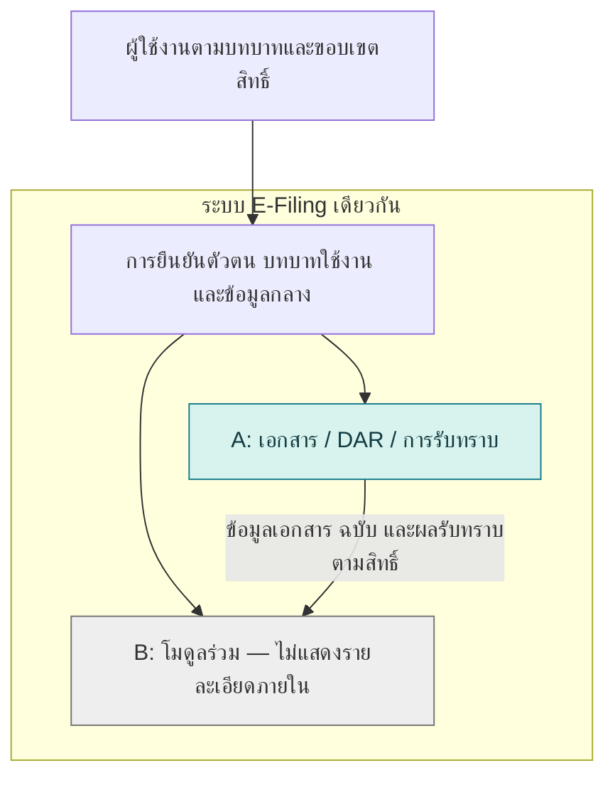

# Software Requirements Specification
## Case X (A) — โมดูลควบคุมเอกสารภายในระบบ E-Filing

| รายการ | รายละเอียด |
| :--- | :--- |
| Artifact | ร่างทบทวน §1–3 ตามโครง CaseX จากฐานข้อกำหนดที่วิเคราะห์ใหม่ |
| Version | ร่างตรวจทานรอบ 1 — 10 กันยายน 2569 |
| สถานะ | Working Draft — ยังไม่แทนที่ GroupA_SRS_v2.md และยังไม่ใช่ SRS ครบฉบับ |
| กรณีศึกษา | Case X (A) — ส่วนควบคุมเอกสารของระบบ E-Filing |
| รายวิชา | ENGSE206 การกำหนดความต้องการและการออกแบบทางซอฟต์แวร์ |
| Branding | ENGSE206 Intensive Weekend Class · SE RMUTL · RMUTL |
| วันที่ | 2569-09-10 |

> เอกสารภายในโครงงาน ไม่เผยแพร่สาธารณะ รหัสข้อกำหนดในร่างนี้อ้างบัญชีที่มีอยู่จริงใน `GroupA_Requirements_Working_Basis.md` §3–10 จนกว่าจะจัดลง §4–6 และภาคผนวกของ SRS การเชื่อม Coverage ไม่ใช่ผลทดสอบหรือการปิด TBD โดย **NFR/CON/AC ยังเป็นข้อเสนอรอตรวจ** ตามสถานะในฐานงาน

| ส่วน | องค์ประกอบ |
| :--- | :--- |
| §1 | Purpose, Conventions, ผู้อ่าน, Scope, References |
| §2 | Context, Capability/Coverage, User Stories, Authority, Environment, Constraints, คู่มือ, Assumptions/Dependencies |
| §3 | Logical Views/Traceability, Hardware, Software Input/Output และ Communications |
| ภาคท้ายร่าง | Coverage, จุดตรวจและงานที่ยังไม่ครบ |

## Revision History

| รอบ | เหตุผล | สถานะ |
| :--- | :--- | :--- |
| 1 | จัดร่าง §1–3 ใหม่จาก Actors, UC, US, FR/BR และข้อเสนอ NFR/CON/AC ให้มีตารางและการสอบกลับตาม CaseX | รอผู้ใช้ตรวจ |

# 1. Introduction

## 1.1 Purpose

เอกสารนี้กำหนดความต้องการซอฟต์แวร์ของโมดูลควบคุมเอกสารคุณภาพ การจัดการคำขอดำเนินการเอกสาร (Document Action Request: DAR) การเผยแพร่ และการรับทราบเอกสาร ภายในระบบ E-Filing ของสำนักงานคณบดีคณะวิศวกรรมศาสตร์ มหาวิทยาลัยเทคโนโลยีราชมงคลล้านนา

เอกสารจัดทำขึ้นเพื่อให้ผู้จัดทำโครงงาน อาจารย์ที่ปรึกษา ผู้ใช้งาน ผู้พัฒนา และผู้ทดสอบ ใช้ตรวจสอบขอบเขต หน้าที่ของระบบ สิทธิ์การดำเนินการ กฎทางธุรกิจ และเกณฑ์การยอมรับร่วมกัน ก่อนนำไปออกแบบ พัฒนา และทดสอบ โดยข้อกำหนดต้องสามารถสอบกลับไปยังเอกสารโครงงาน ระเบียบปฏิบัติ แบบฟอร์ม หรือข้อตัดสินใจที่เกี่ยวข้องได้

ขอบเขตของเอกสารฉบับนี้จำกัดเฉพาะส่วนความรับผิดชอบของกลุ่ม A ซึ่งทำงานร่วมกับโมดูลของกลุ่ม B ภายในระบบเดียวกัน โดยใช้ข้อมูลและกติกาส่วนร่วมอย่างสอดคล้องกัน เอกสารฉบับนี้จะใช้ประกอบการจัดทำ SRS รวมของระบบในภายหลัง

เอกสารอยู่ในสถานะร่างเพื่อทบทวน (Working Draft) โดยจัดทำและตรวจสอบทีละหัวข้อ ประเด็นที่เอกสารต้นทางขัดแย้งกันหรือยังไม่ได้ข้อสรุปจะระบุเป็นรายการรอยืนยัน และไม่ถือเป็นข้อกำหนดที่ได้รับอนุมัติ

## 1.2 Document Conventions

### 1.2.1 รหัสที่ใช้ในเอกสาร

| รหัส | ความหมาย |
| :--- | :--- |
| `FR-A-xx` | ความต้องการเชิงหน้าที่ (Functional Requirement) ของโมดูล A |
| `NFR-A-xx` | ความต้องการนอกเหนือหน้าที่ (Nonfunctional Requirement) |
| `BR-A-xx` | กฎทางธุรกิจ (Business Rule) ที่ระบบต้องบังคับใช้ |
| `CON-A-xx` | ข้อจำกัด (Constraint) ที่กำหนดจากภายนอก |
| `US-A-xx` | เรื่องเล่าของผู้ใช้ (User Story) |
| `UC-A-xx` | กรณีการใช้งาน (Use Case) |
| `AC-A-xx` | เกณฑ์การยอมรับ (Acceptance Criterion) แบบ Given–When–Then |
| `M-A-xx` | องค์ประกอบของแบบจำลอง (Model Element) ในภาคผนวก B |
| `TBD-A-xx` | ประเด็นรอยืนยัน พร้อมผู้รับผิดชอบและหลักฐานที่ใช้ปิดประเด็น |
| `REF-A-xx` | เอกสารต้นทางที่เปิดตรวจสอบแล้ว โดยระบุเวอร์ชันและส่วนที่นำมาใช้ใน §1.5 |
| `OBJ-A-1.2.x` | วัตถุประสงค์ของโครงงานตามหัวข้อ 1.2.x ในบทที่ 1 ของกลุ่ม A |

ใช้ส่วนรหัส `-A-` เพื่อแยกข้อกำหนด แหล่งอ้างอิง และวัตถุประสงค์จากโมดูล B เมื่อจัดทำเอกสารรวม รหัสเดิมที่นำมาอ้างต้องระบุชื่อเอกสารและเวอร์ชันประกอบ และจัดทำตารางเทียบกับรหัสใหม่เพื่อรักษาการสอบกลับ ไม่ถือว่ารหัสที่เหมือนกันในเอกสารต่างฉบับมีความหมายเดียวกัน

### 1.2.2 ระดับความจำเป็นของข้อความ

| คำที่ใช้ | ความหมาย |
| :--- | :--- |
| **ต้อง** (Must / shall) | ข้อกำหนดที่จำเป็นและทวนสอบได้ คำว่า **ห้าม** ใช้ระบุพฤติกรรมที่ต้องไม่เกิดขึ้น |
| **ควร** (Should) | ข้อกำหนดลำดับรอง โดยระบุเงื่อนไขหรือเหตุผลประกอบให้ตรวจสอบได้ |
| **Provisional** | ข้อเสนอหรือค่าตั้งต้นที่ยังไม่ผ่านการยืนยัน ห้ามถือเป็นกฎที่อนุมัติแล้ว และต้องเชื่อมกับ `TBD-A-xx` |
| **⚠️** | จุดที่ต้องตรวจสอบหรือมีข้อขัดแย้ง รวมถึงค่าที่ทีมเสนอขึ้นเอง ต้องมีรายการ `TBD-A-xx` คู่กันในภาคผนวก C |

ระดับความจำเป็นกับสถานะการยืนยันเป็นคนละเรื่อง ข้อความที่ใช้คำว่า “ต้อง” อาจยังเป็น Provisional ได้ และยังไม่ถือเป็นข้อกำหนดที่อนุมัติจนกว่าจะปิดประเด็นที่เกี่ยวข้อง การใช้เครื่องหมายรอยืนยันไม่ใช่เหตุให้สร้างตัวเลขกำหนดเวลาหรือเกณฑ์ทดสอบที่ไม่มีหลักฐาน

### 1.2.3 ศัพท์ที่ต้องไม่ใช้ปะปนกัน

| ศัพท์ | ความแตกต่างที่ใช้ในเอกสาร |
| :--- | :--- |
| **เอกสาร (Document)** / **บันทึก (Record)** | เอกสารใช้กำหนดหรือสนับสนุนการปฏิบัติงาน ส่วนบันทึกเป็นหลักฐานของผลหรือกิจกรรมที่ดำเนินการแล้ว แบบฟอร์มเปล่ากับบันทึกที่กรอกแล้วจึงต้องแยกความหมาย |
| **ฉบับที่ (Issue)** / **แก้ไขครั้งที่ (Revision)** | เป็นข้อมูลแยกช่องตาม Master List ไม่รวมเป็นค่าเวอร์ชันเดียว กฎการเพิ่มค่าต้องพิจารณาจากหลักฐานและระบุในข้อกำหนดที่เกี่ยวข้อง |
| **ทบทวน (Review)** / **อนุมัติ (Approve)** | การตรวจความถูกต้องและความครบถ้วน กับการตัดสินใจอนุญาตให้ดำเนินการ เป็นคนละการกระทำ ผู้มีอำนาจและลำดับจะกำหนดในรายละเอียดที่ผ่านการทบทวน |
| **ถือครอง/รับสำเนา** / **รับทราบเนื้อหา (Acknowledgement)** | การมีหรือรับสำเนาเอกสารไม่ยืนยันโดยอัตโนมัติว่าบุคคลนั้นรับทราบเนื้อหา ต้องแยกเหตุการณ์และหลักฐานที่ใช้ยืนยัน |
| **ฉบับปัจจุบัน** / **สำเนาควบคุม (Controlled Copy)** | ฉบับปัจจุบันบอกว่าเอกสารฉบับใดมีผลใช้งาน ส่วนสำเนาควบคุมบอกลักษณะการควบคุมสำเนา ไฟล์ของฉบับปัจจุบันไม่ถือเป็นสำเนาควบคุมโดยอัตโนมัติ |
| **อนุมัติ DAR** / **ปิด DAR** | การอนุมัติคำขอไม่เท่ากับดำเนินงานครบจนปิดคำขอ เงื่อนไขปิดต้องพิจารณาตามประเภทคำขอและงานที่เกี่ยวข้อง โดยไม่บังคับทุกคำขอให้ทำขั้นตอนเหมือนกัน |

ใช้ชื่อ **ใบขอดำเนินการเอกสาร (Document Action Request: DAR)** ตามแบบฟอร์มจริง รายละเอียดศัพท์จะอ้างอิงจากอภิธานศัพท์ในภาคผนวก A ส่วนตารางนี้ใช้ป้องกันการตีความปะปน ไม่ได้กำหนดสิทธิ์หรืออนุมัติกระบวนการเพิ่มเติม

### 1.2.4 ภาษาที่ใช้ตั้งชื่อสถานะและบทบาท

| สิ่งที่ตั้งชื่อ | ภาษาที่ใช้ | ใช้ที่ไหน |
| :--- | :--- | :--- |
| **ชื่อสถานะและชื่อบทบาท** | ภาษาไทยเป็นชื่อหลัก | เอกสาร ส่วนติดต่อผู้ใช้ ข้อความแจ้งเตือน และรายงานที่ส่งออก |
| **รหัสสถานะและรหัสบทบาท** | รหัสภาษาอังกฤษ ตัวพิมพ์ใหญ่คั่นด้วยขีดล่าง | ฐานข้อมูล ส่วนเชื่อมต่อภายในระบบ และโค้ดโปรแกรม |

ห้ามนำรหัสสถานะและรหัสบทบาทภาษาอังกฤษไปแสดงแทนชื่อภาษาไทยต่อผู้ใช้ ให้จัดทำตารางจับคู่ชื่อกับรหัสเป็นแหล่งอ้างอิงเดียวสำหรับแต่ละชุดข้อมูล และให้หัวข้ออื่นอ้างถึงตารางดังกล่าวแทนการทำสำเนา โดยจะกำหนดตำแหน่งตารางเมื่อร่างรายละเอียดส่วนที่เกี่ยวข้อง

ชื่อสถานะที่เสนอเพื่อใช้ในซอฟต์แวร์ต้องระบุว่าเป็นการออกแบบพฤติกรรมของระบบ ไม่กล่าวว่าเป็นชื่อที่ QP กำหนดโดยตรงหากต้นฉบับไม่ได้ระบุ และไม่แปลงทุกกิจกรรมหรือช่องในแบบฟอร์มเป็นสถานะโดยอัตโนมัติ

## 1.3 Intended Audience and Reading Suggestions

| ผู้อ่าน | ส่วนที่แนะนำ | จุดประสงค์ |
| :--- | :--- | :--- |
| ผู้ใช้งาน/ผู้รับผิดชอบนโยบาย | §1–2, กฎ BR, รายการ TBD และ AC | ยืนยันขอบเขต อำนาจ กระบวนการ และผลที่ยอมรับ |
| ผู้จัดทำ/นักวิเคราะห์ | ทุกส่วน เน้นบัญชีข้อกำหนดและ Coverage | ตรวจที่มา ช่องว่าง และความสอดคล้องของแต่ละรายการ |
| ผู้พัฒนา/ผู้ออกแบบ | §2–3 และบัญชี FR/BR/NFR/CON | เข้าใจข้อมูล พฤติกรรมและสิทธิ์ก่อนออกแบบ ไม่ตีความข้อรอยืนยันเป็นกฎสำเร็จ |
| ผู้ทดสอบ/ผู้ตรวจทาน | FR/BR/NFR/AC, §3 และ TBD | เตรียมสถานการณ์ทวนสอบและตรวจข้อกำหนดที่ยังทดสอบตัดสินไม่ได้ |
| อาจารย์ที่ปรึกษา/ผู้สอน | ประวัติ §1–2 และตาราง Coverage | ตรวจความสอดคล้องกับโครงงานและความพร้อมก่อนรายละเอียด UC |

ตารางนี้เป็นกลุ่มผู้อ่าน ไม่ใช่การให้สิทธิ์ในซอฟต์แวร์ ส่วน §4–6 และภาคผนวกเต็มจะจัดทำภายหลัง ปัจจุบันใช้บัญชีในฐานงานเป็นปลายทางอ้างอิงที่ตรวจได้

## 1.4 Product Scope

ระบบสนับสนุนการเข้าถึงเอกสารที่ถูกต้อง การดำเนินคำขอ และการสอบกลับฉบับ/ผลรับทราบสำหรับสำนักงานคณบดีคณะวิศวกรรมศาสตร์ โมดูล A เป็นเจ้าของข้อมูลเอกสารและฉบับภายในระบบเดียวกับ B

| In Scope ตั้งต้น | Coverage | Out of Scope / Deferred |
| :--- | :--- | :--- |
| เตรียมร่างและไฟล์ประกอบโดยไม่แก้ทับฉบับใช้งาน | FR-A-01–03 | ไม่เขียนเนื้อหาหรือตัดสินความถูกต้องแทนเจ้าของงาน |
| ส่ง ตรวจรับ ทบทวน และพิจารณา DAR | FR-A-04–08 | รายการประเภทและอำนาจที่ขัดกันยัง TBD-A-01, TBD-A-02, TBD-A-06 |
| ขึ้นทะเบียน ประกาศใช้ แทนฉบับเดิม และยกเลิกตามอนุมัติ | FR-A-09–11, FR-A-17 | ไม่เปลี่ยนประเภทสำเนาดิจิทัลหรือกฎ Issue/Revision เอง (TBD-A-04, TBD-A-05) |
| ค้นหา มอบหมายและยืนยันรับทราบต่อฉบับ | FR-A-12–14 | ไม่ถือว่ารับสำเนาหรือเปิดอ่านเท่ากับยืนยันรับทราบ |
| ติดตามประวัติและตรวจงานก่อนปิด DAR | FR-A-15–18 | ไม่ยืนยันคืน/ทำลายกระดาษแทนบุคลากร; เงื่อนไขงานก่อนปิดยัง TBD-A-03 |
| สิทธิ์และข้อมูลร่วมภายในระบบ | FR-A-19–20 | ไม่สร้างชุดบัญชี/ทะเบียนเอกสารซ้ำ; ไม่แก้ขอบเขตหรือไฟล์ B |

**ยังรอยืนยันขอบเขต (TBD-A-03):** ถือครอง/แจกจ่าย เรียกคืน ทำลาย ทบทวนตามรอบ และส่งออกรายงานทะเบียน การพบ FM ไม่ถือว่าเพิ่มฟังก์ชันทั้งหมดโดยอัตโนมัติ

**นอกขอบเขตรอบนี้:** OCR/Scanner integration, Native app, Email/LDAP/AD/HR integration, ระบบบริหารความเสี่ยง และการประชุมทบทวนฝ่ายบริหารเต็มระบบ (CON-A-05 เป็นรหัสข้อเสนอสำหรับข้อจำกัดที่มีฐานจากบทที่ 1 A)

**ความหมายหลัก:** รหัสเอกสารหนึ่งรหัสมีฉบับปัจจุบันได้ไม่เกินหนึ่งฉบับ (BR-A-01) อนุมัติ DAR ไม่เท่ากับปิด DAR (BR-A-08) และการประกาศฉบับใหม่ไม่เปลี่ยนรายการอ้างอิงฉบับเก่าเป็นฉบับใหม่ (BR-A-10)

## 1.5 References

| รหัส | เอกสาร | การใช้ |
| :--- | :--- | :--- |
| `REF-A-01` | `guide/ENGSE206_CaseX_SRS_v1.0_TH.docx` | โครงสร้างเอกสาร |
| `REF-A-02` | `Proposal/SE02_E-filing_GroupA_fix-4_thanit_signed (2).pdf` | เป้าหมายและขอบเขตโครงงาน |
| `REF-A-03` | `Project report/บทที่ 1 A update 2 กันยายน 2569.docx` | วัตถุประสงค์ ขอบเขต และบริบทระบบ |
| `REF-A-04` | `Project report/บทที่ 2 A.docx` | บริบทแนวคิดและเครื่องมือ ไม่รับรองแหล่งอ้างอิงภายในบทโดยอัตโนมัติ |
| `REF-A-05` | QP-2301-0107 การควบคุมเอกสาร Rev.02 ใน `ISO files/` | §4, §6.2 อำนาจดำเนินการ; §6.5–6.6 กระบวนการ; §7–11 การจัดเก็บและเอกสารเกี่ยวข้อง — อ่านครบ 12 หน้า |
| `REF-A-06` | `ISO files/4. แบบฟอร์ม (Form_ Fm)/FM-QP-2301-0107-01 ใบขอดำเนินการเอกสาร (DAR).pdf` Rev.00 | ข้อมูลและรายการดำเนินการของ DAR — อ่านครบ 1 หน้า |
| `REF-A-07` | `ISO files/4. แบบฟอร์ม (Form_ Fm)/FM-QP-2301-0107-02 ทะเบียนชื่อเอกสาร (Master List).pdf` Rev.00 | โครงข้อมูล Master List — อ่านครบ 1 หน้า |
| `REF-A-08` | `ISO files/4. แบบฟอร์ม (Form_ Fm)/FM-QP-2301-0107-03 บัญชีแจกจ่ายเอกสาร (Distribution List).pdf` Rev.00 | โครงข้อมูล Distribution List — อ่านครบ 1 หน้า |
| `REF-A-09` | `ISO files/4. แบบฟอร์ม (Form_ Fm)/FM-QP-2301-0107-04 บันทึกประวัติการทำลายเอกสาร (Document Destruction Log).pdf` Rev.00 | โครงข้อมูลประวัติการทำลาย — อ่านครบ 1 หน้า |
| `REF-A-10` | `More group A resources/01_BRD_v2.8_ISO9001_QMS_EFiling.md` | วัตถุดิบวิเคราะห์ โดยหัวเอกสารยังระบุ v2.7 (`TBD-A-10`) |
| `REF-A-11` | `More group A resources/02_Requirement_List_GroupA_v1.3.md` | เทียบความต้องการเดิม |
| `REF-A-12` | `More group A resources/04_UseCase_GroupA_v2.3_Final.md` | เทียบเป้าหมายและเส้นทางเดิมก่อนร่างใหม่ |
| `REF-A-13` | `More group A resources/05_SRS_GroupA_v1.0.docx` | ตรวจความครอบคลุมและจุดที่ต้องขยาย |
| `REF-A-14` | `GroupB_SRS_v2.md` v0.2 | ตรวจความเข้ากันได้ของข้อมูลและกติกาส่วนร่วมแบบอ่านอย่างเดียว |

ชื่อย่อและไฟล์ต้นทางเพิ่มเติมอยู่ในฐานงาน §1.1 การเปิดเอกสารวิเคราะห์ไม่ได้ยืนยันข้ออ้างภายในทั้งหมด QP §4 กับ §6.2 มีความต่างเรื่องอำนาจ และ QP §6.5.1 กับ FM DAR มีประเภทคำขอไม่ตรงกัน ต้องคง TBD ไว้ เอกสาร ISO ที่มีลายน้ำ Uncontrolled ต้องยืนยันฉบับที่ใช้เป็นข้อผูกพันก่อน Baseline

# 2. Overall Description

## 2.1 Product Perspective

ระบบ E-Filing ใช้สถาปัตยกรรมสามชั้นร่วมกับ Modular Service Design โมดูล A ควบคุมเอกสารและ DAR ส่วนข้อมูลร่วมมีบัญชีผู้ใช้ บทบาท และหน่วยงานชุดกลาง ผู้ใช้งานเข้าใช้ระบบเดียวกันและเลือกบทบาทใช้งานครั้งละหนึ่งบทบาท

ภาพร่างบริบท — ลูกศรจาก A ไป B แสดงทิศทางข้อมูลที่ให้ใช้อ้างอิง ไม่กำหนด push/pull, protocol หรือ dependency ของโค้ด สีใช้แยกความรับผิดชอบภายในระบบ ภาพนี้เป็นร่างตรวจขอบเขตก่อนจัดแผนภาพฉบับเอกสาร

การเชื่อมต่อไม่ให้สิทธิ์อ่านทุกข้อมูล ผู้เรียกต้องได้รับข้อมูลตามสิทธิ์ และการอ้างอิงฉบับต้องรักษาความหมายย้อนหลัง (FR-A-19–20; BR-A-09–10)

## 2.2 Product Functions

### 2.2.1 กลุ่มความสามารถ (Capability Groups)

| Capability Group | หน้าที่หลัก | Requirement Coverage |
| :--- | :--- | :--- |
| CAP-A-01 เตรียมเอกสารและคำขอ | ร่าง/ไฟล์ ส่ง DAR และตรวจรับ | UC-A-01–03; FR-A-01–06; BR-A-01; AC-A-01–04 |
| CAP-A-02 ทบทวนและอนุมัติ | ผลพิจารณาต่อคำขอและฉบับตามอำนาจ | UC-A-04–05; FR-A-07–08; BR-A-03–04; AC-A-05–07 |
| CAP-A-03 ควบคุมทะเบียนและฉบับใช้งาน | ขึ้นทะเบียน ประกาศใช้ ยกเลิกและรักษาประวัติ | UC-A-06–07; FR-A-09–11, FR-A-17; BR-A-01–02, BR-A-06, BR-A-10; AC-A-08–09 |
| CAP-A-04 เข้าถึงและรับทราบ | ค้นหา มอบหมายและยืนยันรับทราบ | UC-A-08–10; FR-A-03, FR-A-12–14; BR-A-05, BR-A-07; AC-A-10–12 |
| CAP-A-05 ติดตามและปิดคำขอ | ความคืบหน้า ประวัติ และเงื่อนไขก่อนปิด | UC-A-11–12; FR-A-05, FR-A-15–17; BR-A-08; AC-A-13–14 |

**พฤติกรรมร่วมทุกกลุ่ม:** Audit Trail (FR-A-18 ตามเหตุการณ์ที่กำหนด) และสิทธิ์ (FR-A-19, BR-A-09, NFR-A-01, AC-A-16) ส่วนข้อมูลอ้างอิงภายใน (FR-A-20, BR-A-10, NFR-A-05, AC-A-15) เป็นข้อกำหนดส่วนเชื่อมต่อ ไม่ตั้ง Use Case ส่งข้อมูลใหม่เพียงเพื่อเติมตาราง

CAP คือการจัดกลุ่มความสามารถ ไม่ใช่ Component และไม่ล็อกจำนวนหน้าจอ AC/NFR ใน Coverage ยังรอผู้ใช้ตรวจ

### 2.2.2 User Story Summary

| ID | User Story | Coverage |
| :--- | :--- | :--- |
| US-A-01 | เจ้าของเอกสารต้องการบันทึกและแก้ร่างพร้อมไฟล์ เพื่อเตรียมพิจารณาโดยไม่กระทบฉบับปัจจุบัน | UC-A-01; FR-A-01–03; AC-A-01–02 |
| US-A-02 | ผู้ขอมีสิทธิ์ต้องการส่ง DAR พร้อมเหตุผลและเอกสาร เพื่อเข้ากระบวนการและติดตามด้วยเลขอ้างอิง | UC-A-02; FR-A-04–05; AC-A-03 |
| US-A-03 | DCC ต้องการตรวจความครบถ้วนและระบุสิ่งที่ขาด เพื่อให้แก้ได้ตรงจุดและส่งต่อเรื่องที่พร้อม | UC-A-03; FR-A-06; AC-A-04 |
| US-A-04 | ผู้ทบทวนต้องการบันทึกผลต่อฉบับที่เสนอ เพื่อสื่อสารความเห็นและสอบกลับฉบับที่ตรวจ | UC-A-04; FR-A-07; BR-A-04; AC-A-05 |
| US-A-05 | ผู้อนุมัติต้องการเห็นเอกสารและผลทบทวนในอำนาจตน เพื่อพิจารณาและบันทึกความรับผิดชอบชัดเจน | UC-A-05; FR-A-08; BR-A-03–04; AC-A-06–07 |
| US-A-06 | DCC ต้องการขึ้นทะเบียนและประกาศฉบับที่อนุมัติ เพื่อให้ใช้ฉบับถูกต้องและสอบกลับฉบับก่อน | UC-A-06; FR-A-09–10, FR-A-17; AC-A-08 |
| US-A-07 | DCC ต้องการยกเลิกตามคำขออนุมัติ เพื่อป้องกันใช้เอกสารยกเลิกพร้อมรักษาประวัติ | UC-A-07; FR-A-11, FR-A-17; AC-A-09 |
| US-A-08 | ผู้มีสิทธิ์อ่านต้องการค้นหาและเห็นฉบับ/สถานะชัดเจน เพื่อเลือกใช้ถูกต้องภายในสิทธิ์ | UC-A-08; FR-A-03, FR-A-12; BR-A-05; AC-A-10 |
| US-A-09 | ผู้มอบหมายต้องการกำหนดและติดตามผู้รับทราบต่อฉบับ เพื่อทราบผู้รับทราบและผู้ยังไม่รับทราบ | UC-A-09; FR-A-13; AC-A-11 |
| US-A-10 | ผู้รับมอบหมายต้องการยืนยันรับทราบฉบับที่เกี่ยวข้อง เพื่อมีหลักฐานบุคคล เวลา และฉบับ | UC-A-10; FR-A-14; BR-A-07; AC-A-12 |
| US-A-11 | ผู้ขอและผู้เกี่ยวข้องต้องการเห็นความคืบหน้า/ความเห็น เพื่อทราบงานที่ต้องดำเนินต่อ | UC-A-11; FR-A-05, FR-A-15, FR-A-17; AC-A-13 |
| US-A-12 | ผู้คุมทะเบียนต้องการตรวจงานและหลักฐานก่อนปิด เพื่อป้องกันการปิด DAR ก่อนงานครบ | UC-A-12; FR-A-16; BR-A-08; AC-A-14 |

## 2.3 User Classes and Characteristics

| Actor / User Class | เป้าหมายและลักษณะ | Authority Boundary |
| :--- | :--- | :--- |
| ผู้บริหาร/สำนักงานคณบดี (Sponsor) | นโยบายและภาพรวม | ไม่ได้สิทธิ์อนุมัติจาก Sponsor อัตโนมัติ; หน้าที่คณบดีตาม QP ต้องจับคู่ต่างหาก |
| เจ้าหน้าที่ควบคุมเอกสาร — ISO/QA Admin (DCC) | ทะเบียน ตรวจ DAR ประกาศใช้ ติดตาม และดูแล user/role ตามกติกากลาง | ประกาศใช้หลังอนุมัติ ไม่อนุมัติ DAR แทนผู้มีอำนาจ; ไม่สร้าง IT/Admin ซ้ำ |
| เจ้าของเอกสาร (Document Owner) | ร่างและคำขอในงานรับผิดชอบ | ไม่อนุมัติคำขอตนเองหรือประกาศใช้เอง; สิทธิ์มอบหมายรับทราบยังรอยืนยัน |
| ผู้อนุมัติ (Approver) | ตัดสินรายการตามการมอบหมาย | เฉพาะอำนาจที่มี ไม่ได้รับสิทธิ์ประกาศใช้จากบทบาทนี้ |
| ผู้แทนฝ่ายบริหาร (QMR) | หน้าที่ด้านเอกสารตามประเภท | QP §6.2 ให้ทบทวน QM และอนุมัติ QP/WI/SD/FM; ต้องยืนยันความต่างกับ §4 ไม่เปลี่ยนสิทธิ์ CAR |
| ผู้ใช้งานเอกสาร (End User) | ค้นหา อ่าน รับทราบ | ตามสิทธิ์/การมอบหมาย ไม่แก้ อนุมัติ หรือประกาศใช้ |
| ผู้ช่วย DCC (Assistant DCC) | หน้าที่ช่วยควบคุมเอกสารที่มอบหมาย | QP มีผู้ช่วย DCC แต่ยังต้องเทียบกับ Actor ใน Carryover ไม่รับสิทธิ์ DCC ทั้งหมดอัตโนมัติ |
| Auditor / Lead Auditor / CAR Owner | ผู้เกี่ยวข้องในระบบร่วม | ไม่เพิ่มสิทธิ์อ่าน/แก้/อนุมัติ A เพียงเพราะมีบทบาท B |
| ทีมพัฒนา A/B | ส่งมอบและตรวจความเข้ากันได้ | Stakeholder ไม่ใช่ role ใช้งาน |

**หน้าที่เพิ่มเติม:** ผู้ทบทวนแยกผลจากอนุมัติแต่ยังไม่ล็อกเป็น role ใหม่; ผู้คุมทะเบียนเทียบ DCC; ผู้ถือครองผูกกับสำเนา; ผู้อนุมัติทำลายยังระบุตำแหน่งไม่ได้จาก FM การเลือก active role ไม่ลบข้อห้ามอนุมัติคำขอตนเอง (BR-A-03, BR-A-09) ประเด็นเหล่านี้คงใน TBD-A-02, TBD-A-06

## 2.4 Operating Environment

- เว็บแอปพลิเคชันสำหรับคอมพิวเตอร์และอุปกรณ์เคลื่อนที่ผ่านเบราว์เซอร์ที่หน่วยงานยืนยัน (CON-A-03; NFR-A-02; TBD-A-07)
- React, Node.js/Express, PostgreSQL และ Prisma เป็นชุดเทคโนโลยีร่วมตามข้อตัดสินใจโครงการ ไม่ล็อกรุ่นหรือสภาพแวดล้อมเครื่องบุคคลแทนเครื่องใช้งานจริง (CON-A-04)
- ใช้ข้อมูลบัญชีและบทบาทกลาง ไม่สมมติว่าบัญชีมหาวิทยาลัยหรือ LDAP พร้อมใช้งาน (CON-A-01, CON-A-05)
- ระบบต้องเชื่อมถึงเครื่องแม่ข่าย ไม่มีขอบเขต offline sync ที่ตกลงไว้

## 2.5 Design and Implementation Constraints

| Constraint | ผลต่อการออกแบบ/พัฒนา |
| :--- | :--- |
| CON-A-01 ระบบเดียว/ตัวตนร่วม | ผูกผู้กระทำกับบัญชีและบทบาทใช้งานชุดกลาง ไม่สร้างระบบสิทธิ์คู่ขนาน |
| CON-A-02 ข้อมูลเอกสารแหล่งเดียว | อ้าง document/version ชุดเดียวตาม FR-A-20 ไม่บังคับ network REST เพียงเพราะเอกสารเดิมระบุ |
| CON-A-03 เว็บ Responsive/สามชั้น | ออกแบบให้ทำงานหลักผ่านเว็บบนอุปกรณ์ที่ยืนยัน และแยกความรับผิดชอบของชั้น |
| CON-A-04 เทคโนโลยีร่วม | ออกแบบภายใต้ React, Node.js/Express, PostgreSQL, Prisma |
| CON-A-05 ขอบเขตการเชื่อมต่อ | ไม่เพิ่มระบบภายนอกและงานที่อยู่นอกขอบเขตใน §1.4 |
| CON-A-06 ภาษา/อำนาจ/สำเนา | ชื่อไทยตาม §1.2 และไม่เปลี่ยนวิธีอนุมัติ/ประเภทสำเนาจากการย้ายเป็นดิจิทัลโดยไม่มีมติ |
| TBD-A-01–06 | ไม่ implement ประเภทคำขอ อำนาจ ขอบเขตเสริม และกฎฉบับจากการเดา |

CON เป็นบัญชีข้อเสนอรอตรวจ แม้ข้อจำกัดหลายเรื่องมีมติเดิมรองรับ การจัดกลุ่มใหม่ไม่ขยายสิทธิ์หรือขอบเขต

## 2.6 User Documentation

| คู่มือ/คำแนะนำ | เนื้อหาที่ต้องช่วยผู้ใช้เข้าใจ | Coverage |
| :--- | :--- | :--- |
| จัดทำร่างและส่ง DAR | ข้อมูลบังคับ เอกสารประกอบ การส่งกลับและการติดตาม | UC-A-01–03, UC-A-11 |
| ทบทวน/อนุมัติ | ฉบับที่พิจารณา อำนาจ ผลพิจารณา และเหตุผล | UC-A-04–05; BR-A-03–04 |
| ควบคุมทะเบียน | ประกาศใช้แทนฉบับเดิม ยกเลิก และตรวจงานก่อนปิด | UC-A-06–07, UC-A-12 |
| ค้นหา/รับทราบ | ฉบับปัจจุบัน ประเภทสำเนา การรับสำเนาเทียบกับรับทราบ | UC-A-08–10; BR-A-05, BR-A-07 |
| สิทธิ์อ้างอิงเร็ว | บทบาทที่ใช้งาน ขอบเขตข้อมูล และข้อห้ามอนุมัติตนเอง | FR-A-19; BR-A-03, BR-A-09 |

รูปแบบและช่องทางส่งคู่มือเป็นการตัดสินใจส่งมอบภายหลัง ไม่กล่าวว่าคู่มือจัดทำเสร็จแล้ว

## 2.7 Assumptions and Dependencies

| Type | รายการ | สถานะ/ผลกระทบ |
| :--- | :--- | :--- |
| Dependency | ข้อมูลบัญชี บทบาท และหน่วยงานร่วม | จำเป็นต่อ FR-A-19–20; ต้องตกลงแหล่งและผู้ดูแลตาม TBD-A-08 |
| Open Policy | ตารางอำนาจและการมอบหมาย | TBD-A-02, TBD-A-06; ยังสรุปผู้ทบทวน/ผู้อนุมัติทุกกรณีไม่ได้ |
| Open Scope | งานถือครอง/แจกจ่าย/เรียกคืน/ทำลาย/ทบทวนตามรอบ/รายงาน | TBD-A-03; ส่งผลต่อเงื่อนไขปิด UC-A-12 |
| Open Policy | Issue/Revision วันที่มีผลใช้ และสำเนาดิจิทัล | TBD-A-04–05; ห้ามเดากฎจากการมีฟิลด์ใน FM |
| Assumption | ข้อมูลเริ่มต้นผ่านการตรวจรหัส ฉบับ สถานะก่อนใช้งาน | ต้องจัดการข้อมูลเดิมที่ผิด/ซ้ำก่อนใช้จริง ยังไม่กำหนดเครื่องมือนำเข้าใหม่ |
| Dependency | บุคลากรบันทึกผลคืน/ทำลายกระดาษเมื่อรับงานนี้เข้าขอบเขต | ระบบไม่ทราบเหตุการณ์ทางกายภาพเอง |
| Dependency | ฉบับอ้างอิงที่หน่วยงานยืนยัน | TBD-A-10; มี Uncontrolled และความต่างระหว่างเอกสาร |
| Open Quality Target | อุปกรณ์ โหลด เกณฑ์ไฟล์ และสำรองกู้คืน | TBD-A-07, TBD-A-09, TBD-A-11–12 (สองรายการท้ายเป็นข้อเสนอใหม่) |

# 3. External Interface Requirements

ชื่อหัวข้อคงตามเทมเพลต ส่วนระหว่าง A/B เป็น Internal Module Interface ภายในระบบเดียว

## 3.1 User Interfaces

กำหนดลักษณะมุมมองเชิงตรรกะเพื่อรองรับข้อกำหนด ไม่ล็อก Wireframe, Component Library หรือจำนวนหน้าจอ

| Logical View | ข้อมูล/Action ที่ต้องรองรับ | Traceability |
| :--- | :--- | :--- |
| บริบทผู้ใช้/บทบาท | ตัวตน บทบาทที่ใช้งาน และการเลือก/สลับตามสิทธิ์ร่วม | FR-A-19; BR-A-09; AC-A-16 |
| ร่างเอกสาร | ข้อมูลหลัก ฉบับ และไฟล์ที่แก้ได้ในขอบเขตตน | FR-A-01–03; AC-A-01–02 |
| แบบคำขอ DAR | ประเภท รายละเอียด เหตุผล ฉบับ/ไฟล์ประกอบ และเลขอ้างอิง | FR-A-04–05; AC-A-03; TBD-A-01 |
| ตรวจรับ | ข้อมูลที่ขาด ผลตรวจและเหตุผลส่งกลับ | FR-A-06; AC-A-04 |
| ทบทวน/พิจารณา | ฉบับและคำขอ ความเห็น และคำสั่งตามอำนาจที่ยืนยัน | FR-A-07–08; BR-A-03–04; AC-A-05–07 |
| ทะเบียน/ประกาศใช้ | Issue/Revision วันที่มีผลใช้ ฉบับปัจจุบันและยกเลิก | FR-A-09–11; BR-A-01–02, BR-A-06; AC-A-08–09 |
| ค้นหา/เปิดเอกสาร | ตัวกรอง ฉบับ/สถานะ และไฟล์ตามสิทธิ์ | FR-A-03, FR-A-12; BR-A-05; AC-A-10 |
| มอบหมาย/ติดตามรับทราบ | รายบุคคลต่อฉบับและผลรับทราบ | FR-A-13; AC-A-11 |
| ยืนยันรับทราบ | ฉบับที่จะยืนยัน ผลและประวัติการยืนยัน | FR-A-14; BR-A-07; AC-A-12 |
| ติดตาม/ประวัติ | สถานะคำขอ ความเห็น เหตุการณ์ และงานต่อไปตามสิทธิ์ | FR-A-15, FR-A-17–18; AC-A-13 |
| ตรวจปิด DAR | งาน/หลักฐานที่จำเป็นตามประเภท และผลปิด | FR-A-16; BR-A-08; AC-A-14; TBD-A-03 |

**UI wording checkpoint:** แยกสถานะเอกสารจาก DAR; อนุมัติไม่เท่ากับปิด; ฉบับปัจจุบันไม่เท่ากับสำเนาควบคุม; อ่านไม่เท่ากับรับทราบ; ข้อมูลไม่พร้อมไม่แสดงเป็นศูนย์รายการ ไม่ตั้งหน้าจองานที่ TBD-A-03 ยังไม่รับเข้าขอบเขต

## 3.2 Hardware Interfaces

ไม่มีส่วนเชื่อมต่ออุปกรณ์เฉพาะที่ตกลงในรอบนี้ ใช้อุปกรณ์มาตรฐานที่เปิดเบราว์เซอร์ได้ การเลือกไฟล์จากเครื่องไม่เท่ากับ Scanner integration หรือ OCR (CON-A-03, CON-A-05; TBD-A-07)

## 3.3 Software Interfaces

| Interface | Input to Module A | Output from Module A | Constraint / TBD |
| :--- | :--- | :--- | :--- |
| ตัวตนและสิทธิ์ร่วม | ผู้ใช้ บทบาทที่ใช้งาน หน่วยงาน และสถานะสิทธิ์ที่จำเป็น | คำขอตรวจสิทธิ์/บริบทของการกระทำ | FR-A-19; NFR-A-01; CON-A-01; TBD-A-06, TBD-A-08 |
| ข้อมูลเอกสาร/ฉบับภายในระบบ | คำขออ้างอิงเอกสารหรือฉบับพร้อมบริบทสิทธิ์ | ข้อมูลหลัก ฉบับ สถานะ วันที่มีผลใช้ และข้อมูลไฟล์ที่อนุญาต | FR-A-20; BR-A-10; AC-A-15; TBD-A-08 |
| ผลรับทราบภายในระบบ | คำขออ่านตามเอกสาร/ฉบับและขอบเขตสิทธิ์ | ผลหรือข้อมูลสรุปการรับทราบที่อนุญาต | FR-A-13–14, FR-A-20; NFR-A-05; TBD-A-08 |
| พื้นที่จัดเก็บไฟล์ | ผลบันทึก/อ่านไฟล์และข้อผิดพลาด | คำขอจัดเก็บ/อ่านไฟล์ที่ผูกกับร่าง ฉบับ หรือ DAR | FR-A-03–04; NFR-A-03–04; TBD-A-09, TBD-A-11; ยังไม่ล็อกเทคโนโลยีจัดเก็บเพิ่ม |
| ฐานข้อมูล | ผลอ่าน/บันทึกและข้อผิดพลาด | คำสั่งอ่าน/บันทึกตามธุรกรรม | FR-A-01–20; NFR-A-03–04; CON-A-04 |

รหัสร่วมที่ต้องตกลง: `user_id`, `role_id`, `department_id`, `document_id`, `document_code`, `version_id`, `file_id` โดย `version_id` ไม่แทนความหมาย Issue/Revision ไม่กำหนด endpoint, payload หรือ protocol ก่อนการออกแบบ

เมื่ออ่านข้อมูลไม่พร้อมต้องแยกจากผลว่างที่อ่านสำเร็จ และถ้าตรวจสิทธิ์หรือบันทึกไม่สำเร็จต้องไม่รายงานสำเร็จ (NFR-A-01, NFR-A-03, NFR-A-05) Input/Output แสดงหน้าที่การแลกเปลี่ยนข้อมูล ไม่ยืนยันว่าเป็นระบบภายนอกหรือบริการอิสระ

## 3.4 Communications Interfaces

- ทุกคำสั่งที่มีอำนาจต้องรักษาบริบทตัวตนและบทบาทใช้งาน และตรวจสิทธิ์ก่อนคืนข้อมูลหรือเปลี่ยนข้อมูล (FR-A-19; BR-A-09; NFR-A-01)
- ข้อความผลดำเนินการต้องระบุรายการที่เกี่ยวข้องและผลสำเร็จ/ข้อผิดพลาดอย่างไม่คลุมเครือ ไม่เผยข้อมูลเกินสิทธิ์ (FR-A-15, FR-A-19; NFR-A-02)
- HTTPS สำหรับการใช้งานจริงคงตามร่าง §3.4 ที่ผู้ใช้ยอมรับก่อนหน้า; รายละเอียด session, protocol ภายใน, timeout, retry และขนาดไฟล์ยังไม่กำหนดตัวเลข (TBD-A-08–09)
- การสื่อสารระหว่างโมดูลไม่จำเป็นต้องผ่านเครือข่าย ไม่เพิ่มการเชื่อมต่อระบบที่อยู่นอก CON-A-05

---

## จุดตรวจของร่างรอบนี้

- การตรวจ Coverage เป็นการตรวจเอกสาร ไม่ใช่การทดสอบซอฟต์แวร์หรือยืนยันผลผ่าน AC
- FR-A-01–20 มีจุดใช้งานในกลุ่มความสามารถหรือข้อกำหนดร่วม; UC-A-01–12 และ US-A-01–12 มีคู่เชื่อม; ไม่อ้างว่า AC ครอบคลุมทุกข้อยกเว้นแล้ว
- NFR/CON/AC และ TBD-A-11–12 ยังรอตรวจ ไม่เลื่อนสถานะเพราะถูกอ้างในร่างนี้
- ภาพบริบทเป็นภาพร่างเชิงแนวคิด ต้องตรวจและจัดเป็นรูปแบบเอกสารเมื่อทำแผนภาพฉบับส่งมอบ ยังไม่ใช่ Word export
- Detailed Use Case และแบบจำลองสถานะยังไม่จัดทำ การจับคู่เป้าหมายกับวัตถุประสงค์บทที่ 1 ต้องตรวจเลขหัวข้อจริงก่อนเพิ่ม OBJ ลง Coverage
- ก่อนนำไปแทนที่ SRS A ต้องให้ผู้ใช้ตรวจ เก็บสำเนา A เดิม และตรวจ §1.1–1.2/ไฟล์ B คงเดิม
